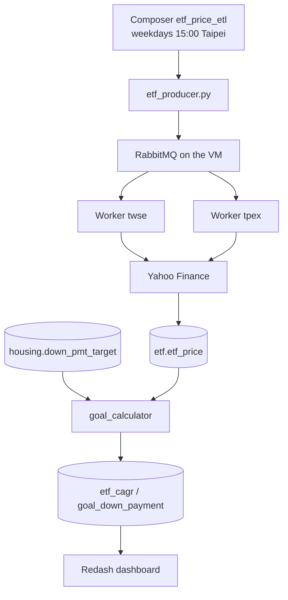

<p align="center"><a href="README.md">中文</a> | <strong>English</strong></p>

<h1 align="center">ETF Down-Payment Goal</h1>

<p align="center">Use the history of passive ETFs to estimate how much to save each month for a down payment in Taiwan's six special municipalities.</p>

<p align="center">
  <a href="https://github.com/tibameDataEngineer1150701/etf-goal-calculator/stargazers"></a>
  
  
  
</p>

<p align="center">
  Live dashboard: <a href="http://34.81.69.39:5000">Six-city down payment</a> (after login, open it under Dashboards)
</p>

The GCP VM `etf-manager` (`asia-east1-b`, `e2-medium`, external IP `34.81.69.39`, internal IP `10.140.0.2`) is running. Prices, housing data, and the goal calculation are in MySQL.

Weekday 15:00 Taipei time is scheduled by the shared Composer environment `composer` in project `etf-goal` (`us-east4`, Airflow 2.11.1). DAG `etf_price_etl` uses `KubernetesPodOperator` to run `etf_producer.py` and send `stock.etf_list` to RabbitMQ on the VM. The TWSE and TPEx workers stay on the VM and take the tasks. `etf-jobs` scheduler is scaled to 0 so it does not send the list again. The 2026-11-09 15:00 run succeeded, and the workers wrote `etf.crawl_one` results into MySQL. `etf.etf_price` has 393,883 rows through 2026-11-09. That day has prices for 236 symbols, against 279 on 11/6, because some Yahoo requests failed. MySQL `3306` and RabbitMQ `5672` accept traffic only from the Composer pod range `10.28.0.0/17`.

Airflow is not installed on the VM. This machine is an `e2-medium` with about 4 GB of memory, and it already runs MySQL, RabbitMQ, two workers, Flower, Portainer, and Redash. Airflow's web server, scheduler, and database need about 4 GB by themselves. Composer is the shared Airflow in the same GCP project.

The Docker Hub account is `mark0403`. VM workers use `mark0403/etf-crawler:0.0.1`. The Composer producer uses `mark0403/etf-crawler:0.0.2.composer`, built from `docker/prod.with.env.Dockerfile`. Passwords live in the Composer Airflow Variables `mysql_password` and `rabbitmq_password`, not in Git.

## Features

| | | |
| --- | --- | --- |
| 📈 **Prices** | Yahoo adjusted close `adj_close`. Listed `.TW`, OTC `.TWO` | `etf.etf_price`, 393,883 rows, latest 2026-11-09 |
| 📋 **Universe** | FinMind list with active, leveraged, and inverse ETFs removed | `stock.etf_list`, 333 symbols |
| 🏠 **Housing** | Price of a 30-ping home, then a 10-year down payment from the house-price index | `housing.down_pmt_target`, 36 rows |
| 🧮 **Goal** | Existing-home sales, neutral case. 0050 is about 20.28% a year | `etf.goal_down_payment`, one row per city |
| 📊 **Dashboard** | Change the ETF, years, and monthly amount | Redash dashboard |
| ⏱️ **Schedule** | Composer sends tasks. Two Celery workers on the VM, one for TWSE and one for TPEx | Weekdays at 15:00 |

`crawlers/finmind` is a separate daily-price crawler. Return calculations read `etf.etf_price`, not that pipeline.

## Quick Start

The VM is already up. You do not need to crawl again on your own computer.

| Service | URL |
| --- | --- |
| Redash | http://34.81.69.39:5000 |
| phpMyAdmin | http://34.81.69.39:8080 |
| RabbitMQ | http://34.81.69.39:15672 |
| Flower | http://34.81.69.39:5555 |
| Portainer | http://34.81.69.39:9000 |
| Airflow | [Composer `composer`](https://9ac02a6cb8fc427eb49d61045f3e7fc2-dot-us-east4.composer.googleusercontent.com) |

## Installation

To run locally, install Docker Desktop, Python 3.11, and [uv](https://docs.astral.sh/uv/). Do not also start `mysql.yml` under `crawlers/housing` or `crawlers/finmind`. Those files bind port 3306 as well.

<details>
<summary>Linux / macOS</summary>

```bash
git clone https://github.com/tibameDataEngineer1150701/etf-goal-calculator.git
cd etf-goal-calculator
docker compose -f docker/docker-compose.yml up -d --build mysql phpmyadmin
cd crawlers/stock && uv sync
export MYSQL_HOST=127.0.0.1 MYSQL_PORT=3306 MYSQL_USER=root MYSQL_DATABASE=stock
uv run python -m crawler.save_etf_list
cd ../..
docker compose -f docker/docker-compose.yml run --rm crawler
```

</details>

<details>
<summary>Windows PowerShell</summary>

```powershell
git clone https://github.com/tibameDataEngineer1150701/etf-goal-calculator.git
cd etf-goal-calculator
docker compose -f docker/docker-compose.yml up -d --build mysql phpmyadmin
cd crawlers/stock
uv sync
$env:MYSQL_HOST = "127.0.0.1"
$env:MYSQL_PORT = "3306"
$env:MYSQL_USER = "root"
$env:MYSQL_DATABASE = "stock"
uv run python -m crawler.save_etf_list
cd ../..
docker compose -f docker/docker-compose.yml run --rm crawler
```

</details>

<details>
<summary>Update the crawler on the VM</summary>

MySQL and RabbitMQ on the VM are already on the `etf_etf` network. Do not start the local `celery-compose.yml` there.

```bash
cd ~/etf-goal-calculator
git pull
sudo docker pull mark0403/etf-crawler:0.0.1
sudo docker stack deploy -c swarm.yml etf-jobs
sudo docker service scale etf-jobs_scheduler=0
```

The scheduler in `swarm.yml` defaults to 1 replica. Scale it to 0 after deploy so only Composer sends the 15:00 tasks. Leave both workers at 1.

</details>

## Architecture



`dags/etf_etl_dag.py` only dispatches work. The VM workers crawl prices. For a local exercise, start MySQL, then `docker/celery-compose.yml`, and dispatch with `--profile dispatch`.

## Data and queries

Counts are from the VM on 2026-11-03.

| Table | Contents | Rows |
| --- | --- | --- |
| `stock.etf_list` | Passive ETF list | about 279 |
| `etf.etf_price` | `date`, `stock_id`, `adj_close` | about 392,253 |
| `etf.etf_cagr` | Annualized return for each symbol | symbols with a quote |
| `etf.goal_down_payment` | Down payment and required monthly savings | 6 |
| `housing.down_pmt_target` | Existing and presale homes, three scenarios. The goal uses existing-home sales, neutral | 36 |
| `housing.housing_txn_qtr` | Unit price in TWD per square meter, and trade counts | 516 |
| `housing.housing_price_index` | Official house-price index | 385 |
| `housing.cpi` | Quarterly CPI from 2016Q1 | 43 |
| `housing.hpi` | Real house-price index. The CSV file is `real_hpi.csv` | 287 |
| `housing.city_house_price` | 2026Q3 median total price. Unused while the neutral existing-home rows exist | 6 |

Tables are created in [`crawlers/etf/schema.sql`](crawlers/etf/schema.sql). The dashboard query is:

```sql
SELECT
  p.city,
  p.house_price_wan,
  p.down_payment,
  c.stock_id,
  ROUND(c.cagr * 100, 2) AS cagr_pct,
  ROUND(
    p.down_payment * (c.cagr / 12)
    / (POW(1 + c.cagr / 12, {{years}} * 12) - 1)
  ) AS monthly_needed,
  ROUND(
    {{monthly_invest}} * (POW(1 + c.cagr / 12, {{years}} * 12) - 1) / (c.cagr / 12)
  ) AS accumulated,
  CASE
    WHEN {{monthly_invest}} * (POW(1 + c.cagr / 12, {{years}} * 12) - 1) / (c.cagr / 12)
         >= p.down_payment
    THEN '可付' ELSE '不足'
  END AS can_pay
FROM (
  SELECT
    CASE region
      WHEN '臺北市' THEN '台北市'
      WHEN '臺中市' THEN '台中市'
      WHEN '臺南市' THEN '台南市'
      ELSE region
    END AS city,
    ROUND(house_price / 10000) AS house_price_wan,
    ROUND(down_payment_target) AS down_payment
  FROM housing.down_pmt_target
  WHERE transaction_type = '成屋買賣'
    AND scenario = '中性'
) p
JOIN etf_cagr c ON c.stock_id = '{{etf}}'
ORDER BY p.house_price_wan DESC
```

`可付` means the savings cover the down payment. `不足` means they do not. `成屋買賣` is an existing-home sale and `中性` is the neutral scenario.

Save and run `SELECT stock_id FROM etf_cagr ORDER BY stock_id` before the ETF dropdown has choices. The bar chart uses `city` on X and `monthly_needed` on Y. When adding widgets, set each parameter source to Dashboard, then Publish.

Housing pipeline:

- `WebCrawler_cpi.py` treats a non-positive value in the current month, a future month, or the immediately previous month as not yet published and drops it. In early November 2026 that removes `2026-M10` and `2026-M11`.
- `Real_HPI.py` includes teammate commit `c10e92a` from `real-estate-hpi-cpi-pipeline`. Each region's official HPI is rebased so the 2016 quarterly average is 100, then divided by CPI on the same base. Existing homes and presale homes stay separate by transaction type. The CPI average print was rewritten so it runs on Python 3.11.

Local environment variables are listed at the top of `crawlers/etf/goal_calculator.py`. Common ones are `MYSQL_HOST`, `PRIMARY_ETF` (default `0050`), `INVEST_YEARS` (default `10`), and `MONTHLY_INVEST`. Production hosts are in the `PRODUCTION` section of `crawlers/etf/local.ini.example`. Do not commit real passwords.

## Still open

- The architecture drawing lives in this README as Mermaid. A separate image file has not been uploaded.

## Project issues

1. Data Ingestion
Technical Challenge: Data Source Access Restrictions and Multi-Source Data Ingestion
1.1 Web Scraping Access Restrictions
- Problem: TLS certificate verification issues or website access restrictions on the Ministry of the Interior's Real Estate Transaction Price Registration website prevented the crawler from retrieving data successfully.
- Solution: Tested verify=False for specific data sources to troubleshoot certificate verification issues. Valid certificate verification should still be maintained in production environments.
- Recommendation: For production environments, configure the appropriate CA certificates or certificate chain instead of disabling certificate verification.
1.2 Complex Filtering Conditions on the Real Estate Transaction Website
- Problem: The website's homepage required multiple filtering conditions to retrieve transaction data, increasing crawler complexity and maintenance costs.
- Solution: Switched to scraping the authenticated page and downloading quarterly ZIP archives covering the past ten years, reducing the complexity of data retrieval and filtering.
1.3 Inconsistent Data Formats Across Multiple Sources
- Problem: Public datasets from different sources had inconsistent column definitions and file formats, making direct integration difficult.
- Solution: Developed separate crawler modules for each data source, performed initial data cleaning and column standardization, and consolidated the processed data into Parquet format for downstream analysis.
1.4 Different Ingestion Methods for Different Data Sources
- Problem: The ETF master list and historical ETF price data came from different sources, with different data formats and API access methods.
- Solution:
  - Used FinMind to retrieve the list of passive ETFs.
  - Used Yahoo Finance to retrieve price data for ETFs listed on the Taiwan Stock Exchange (.TW) and Taipei Exchange (.TWO).
  - Developed separate ingestion modules to reduce coupling between data sources.
1.5 External API Request Failures
- Problem: Some Yahoo Finance API requests failed, resulting in missing price data for certain ETFs on specific trading days.
- Solution:
  - Processed TWSE-listed and TPEx-listed ETFs separately.
  - Distributed data ingestion tasks to dedicated workers.
  - Logged failed tasks for subsequent investigation and data retrieval retries.

2. Data Quality
Technical Challenge: Missing Data, Inconsistent Formats, and Data Completeness Validation
2.1 Missing or Abnormal Values in HPI and CPI Data
- Problem: Missing columns, inconsistent data types, abnormal numerical values, or duplicate records could affect CAGR calculation results.
- Solution: Developed a validate_source_data() function to validate required columns, data types, numerical ranges, and data uniqueness before calculating CAGR.
2.2 Inconsistent CSV Schemas
- Problem: Some raw CSV files contained a different number of fields between the header and data rows, resulting in parsing errors or data loss.
- Solution: Inspected headers and abnormal records, investigated the underlying issues, and normalized inconsistent records instead of directly skipping potentially valid data.
2.3 Duplicate Records and Invalid Transaction Data
- Problem: Duplicate transactions, invalid dates, missing values, or non-positive transaction prices could affect statistical results.
- Solution: Implemented duplicate record detection, transaction date validation, and price range checks. Errors are raised when anomalies are detected, allowing the issues to be identified during processing.
2.4 Incomplete ETF Price Data
- Problem: External API request failures could result in inconsistent data coverage and different latest available dates across ETFs.
- Observed Data: According to the README, price data was successfully retrieved for 236 ETFs on November 9, 2026, compared with 279 ETFs on the previous trading data date, November 6, 2026.
- Solution and Improvement Areas:
  - Check data coverage between the ETF master list and price records.
  - Verify the latest available price date for each ETF.
  - Identify ETFs with missing price records.
  - Retry failed tasks and retrieve missing historical data.
2.5 ETF Price Data Validation
- Problem: Missing values, non-positive prices, or duplicate records could affect CAGR calculations.
- Data Validation Rules:
  - stock_id must not be null.
  - date must follow the expected date format.
  - adj_close must be a positive numerical value.
  - Ensure uniqueness of the composite key (stock_id, date).

3. Data Transformation
Technical Challenge: Data Standardization and Time-Series Transformation
3.1 Inconsistent Data Formats and Column Definitions
- Problem: Real estate transaction data, HPI, and CPI datasets used different column names, date formats, and data structures, making direct calculations and integration difficult.
- Solution: Used Pandas to transform columns, standardize data types, and clean the datasets.
3.2 Different Time Granularities Across Data Sources
- Problem: CPI data was available monthly, whereas HPI and real estate transaction data were available quarterly, making direct integration and comparison difficult.
- Solution: Converted monthly CPI data into quarterly averages to align the time dimensions across all three datasets.
3.3 Comparison Between Nominal HPI and Real HPI
- Problem: The nominal House Price Index (HPI) does not account for changes in consumer prices, making it insufficient to reflect housing price movements after adjusting for inflation.
- Solution: Normalized CPI to a 2016 base year of 100 and incorporated it into the calculation of the Real House Price Index (Real HPI).

4. Data Selection & Filtering
Technical Challenge: Selective Extraction from Large Volumes of Raw Data
4.1 Unnecessary Data Increasing Processing Overhead
- Problem: Real estate transaction ZIP archives contained multiple types of CSV files. Extracting and cleaning all files would increase disk I/O, storage requirements, and processing time.
- Solution:
  - Used zip_ref.namelist() to identify and selectively extract the required CSV files:
    - A: Existing House Transactions
    - B: Pre-sale House Transactions
    - C: Rental Transactions
  - Excluded unnecessary C CSV files (rental transactions).
  - Extracted only the required transaction datasets and related schema and manifest files to support subsequent data cleaning.
4.2 Irrelevant Data Affecting Analytical Results
- Problem: Some records did not meet the predefined project scope or analytical criteria, such as transactions involving certain luxury residential developments.
- Solution: Applied additional filters based on transaction type, transaction date, price, and geographic region.

5. Data Integration
Technical Challenge: Aligning Data Periods Across Cities and Multiple Sources
5.1 Inconsistent Latest Available Quarters Across Cities
- Problem: Real estate transaction data was updated at different times across counties and cities. The latest available quarter was therefore not necessarily consistent, potentially introducing temporal bias into comparisons.
- Solution:
  - Defined consistent data period alignment rules.
  - Established a common analysis period based on research requirements.
  - Checked data coverage across different cities and counties.
5.2 Integrating Quarterly Data from Multiple Sources
- Problem: Real estate transaction data, HPI, and CPI datasets had different reporting periods and time field definitions.
- Solution: Created standardized quarterly fields and used them as common join keys to integrate the datasets and ensure consistent time periods.

6. Data Pipeline Reliability
Technical Challenge: Long-Running Data Downloads, Interruption Recovery, and Task Monitoring
6.1 Long-Running Historical Data Downloads and Unexpected Interruptions
- Problem: Downloading ten years of historical real estate transaction ZIP archives was time-consuming. Unexpected interruptions could result in incomplete downloads or redundant downloads.
- Solution:
  - Used zip_path.exists() to check whether a downloaded file already existed.
  - Used zipfile.is_zipfile() to verify whether the file was a valid ZIP archive, rather than relying solely on file existence to determine download success.
  - Introduced intervals between quarterly download requests to reduce request frequency.
  - Maintained error logs to identify failed quarters and support subsequent retries.
6.2 Independent Execution and Management of Multiple ETL Tasks
- Problem: Real estate transaction, HPI, and CPI data ingestion and processing involved different workflows. Executing all tasks in a single process would make task management and future scalability more difficult.
- Solution:
  - Used Celery to execute asynchronous tasks.
  - Used RabbitMQ as the message broker.
  - Created independent queues and workers for different data sources.
  - Used Flower to monitor task execution status.
6.3 Execution Environment and Service Management
- Problem: Multiple services required consistent execution environments and reliable communication between containers.
- Solution: Used Docker and Docker Compose to build a containerized environment, with Docker Networks to manage inter-service communication.

7. Distributed Task Processing
Technical Challenge: Task Distribution and Parallel Processing of Large-Scale ETF Price Retrieval Jobs
7.1 Processing Efficiency of a Single Worker Handling Multiple ETF Tasks
- Problem: A large number of ETFs required individual historical price retrieval. Assigning all tasks to a single worker could significantly increase processing time.
- Solution:
  - Used Celery to create asynchronous tasks.
  - Used RabbitMQ as the message broker.
  - Distributed TWSE-listed and TPEx-listed ETF tasks to separate workers.
  - Used Flower to monitor task execution status.
  
## FAQ

1. HPI Base Period

- The HPI base period used in this project differs from the base period (2013 annual average = 100) adopted in the National Policy Foundation's report, Comparison and Applications of Taiwan's Housing Price Indices.

  - The data period is set to 2016–2026 (10 years).

  - The program assumes 2016 = 100 as the HPI base period.

  - The analysis focuses on relative price trends rather than interpreting the percentage increase above the base period as an absolute measure.

2. Floor Area Measurement

- Transaction prices per ping (坪) in Taiwan's Real Estate Transaction Price Registration System are calculated based on the transferred floor area, including shared facilities.

- This project assumes that the floor area refers to the registered building area (權狀坪數) to maintain a consistent measurement basis and avoid overestimating or underestimating property values due to differences in floor area definitions.

3. HPI Geographic Coverage

- The HPI data is available only at the city/county level. If a user selects a district, the corresponding city/county-level HPI growth rate will be applied.

- The project assumes a property purchase in one of Taiwan's six special municipalities within the next 10 years (by 2036). Therefore, the analysis focuses primarily on city/county-level data.

4. Historical Market Conditions

- The 2016–2026 period represents a decade-long bull market in Taiwan's real estate sector. Using this period to project the next decade may therefore produce distorted or unreliable estimates.

- This project does not constitute investment advice. Its scope is limited to demonstrating programming logic, data flows, data engineering practices, and technical implementation.

## Contributors

- [mark900403](https://github.com/mark900403)
- [athlan0726](https://github.com/athlan0726)
- [wayne_hung](https://github.com/wayne_hung)
- [rchingyun](https://github.com/rchingyun)
- [yuyumomo](https://github.com/yuyumomo)

<a href="https://github.com/tibameDataEngineer1150701/etf-goal-calculator/graphs/contributors">
  
</a>

This is a course project and has no sponsorship. The results check the data pipeline. They are not investment advice.
