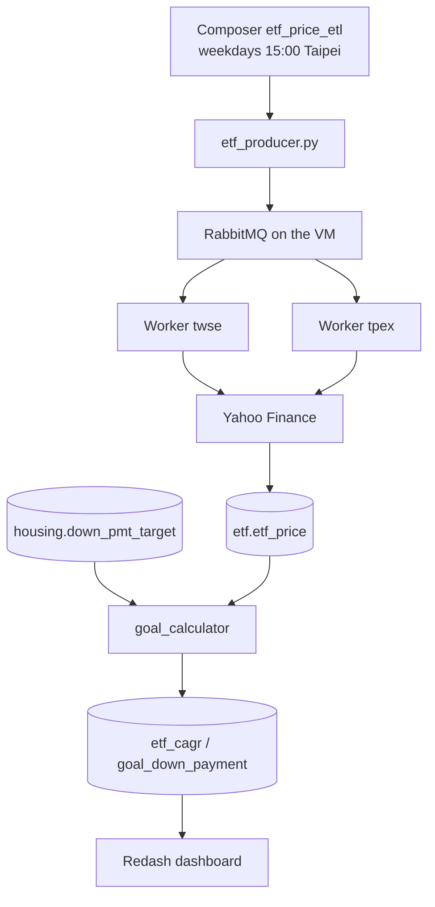

<p align="center"><a href="README.md">中文</a> | <strong>English</strong></p>

<h1 align="center">ETF Down-Payment Goal</h1>

<p align="center">Use the history of passive ETFs to estimate how much to save each month for a down payment in Taiwan's six special municipalities.</p>

<p align="center">
  <a href="https://github.com/tibameDataEngineer1150701/etf-goal-calculator/stargazers"></a>
  
  
  
</p>

<p align="center">
  Live dashboard: <a href="http://34.81.69.39:5000">Six-city down payment</a> (after login, open it under Dashboards)
</p>

The GCP VM `etf-manager` (`asia-east1-b`, `e2-medium`, external IP `34.81.69.39`, internal IP `10.140.0.2`) is running. Prices, housing data, and the goal calculation are in MySQL.

Weekday 15:00 Taipei time is scheduled by the shared Composer environment `composer` in project `etf-goal` (`us-east4`, Airflow 2.11.1). DAG `etf_price_etl` uses `KubernetesPodOperator` to run `etf_producer.py` and send `stock.etf_list` to RabbitMQ on the VM. The TWSE and TPEx workers stay on the VM and take the tasks. `etf-jobs` scheduler is scaled to 0 so it does not send the list again. The 2026-11-09 15:00 run succeeded, and the workers wrote `etf.crawl_one` results into MySQL. `etf.etf_price` has 393,883 rows through 2026-11-09. That day has prices for 236 symbols, against 279 on 11/6, because some Yahoo requests failed. MySQL `3306` and RabbitMQ `5672` accept traffic only from the Composer pod range `10.28.0.0/17`.

Airflow is not installed on the VM. This machine is an `e2-medium` with about 4 GB of memory, and it already runs MySQL, RabbitMQ, two workers, Flower, Portainer, and Redash. Airflow's web server, scheduler, and database need about 4 GB by themselves. Composer is the shared Airflow in the same GCP project.

The Docker Hub account is `mark0403`. VM workers use `mark0403/etf-crawler:0.0.1`. The Composer producer uses `mark0403/etf-crawler:0.0.2.composer`, built from `docker/prod.with.env.Dockerfile`. Passwords live in the Composer Airflow Variables `mysql_password` and `rabbitmq_password`, not in Git.

## Features

| | | |
| --- | --- | --- |
| 📈 **Prices** | Yahoo adjusted close `adj_close`. Listed `.TW`, OTC `.TWO` | `etf.etf_price`, 393,883 rows, latest 2026-11-09 |
| 📋 **Universe** | FinMind list with active, leveraged, and inverse ETFs removed | `stock.etf_list`, 333 symbols |
| 🏠 **Housing** | Price of a 30-ping home, then a 10-year down payment from the house-price index | `housing.down_pmt_target`, 36 rows |
| 🧮 **Goal** | Existing-home sales, neutral case. 0050 is about 20.28% a year | `etf.goal_down_payment`, one row per city |
| 📊 **Dashboard** | Change the ETF, years, and monthly amount | Redash dashboard |
| ⏱️ **Schedule** | Composer sends tasks. Two Celery workers on the VM, one for TWSE and one for TPEx | Weekdays at 15:00 |

`crawlers/finmind` is a separate daily-price crawler. Return calculations read `etf.etf_price`, not that pipeline.

## Quick Start

The VM is already up. You do not need to crawl again on your own computer.

| Service | URL |
| --- | --- |
| Redash | http://34.81.69.39:5000 |
| phpMyAdmin | http://34.81.69.39:8080 |
| RabbitMQ | http://34.81.69.39:15672 |
| Flower | http://34.81.69.39:5555 |
| Portainer | http://34.81.69.39:9000 |
| Airflow | [Composer `composer`](https://9ac02a6cb8fc427eb49d61045f3e7fc2-dot-us-east4.composer.googleusercontent.com) |

## Installation

To run locally, install Docker Desktop, Python 3.11, and [uv](https://docs.astral.sh/uv/). Do not also start `mysql.yml` under `crawlers/housing` or `crawlers/finmind`. Those files bind port 3306 as well.

<details>
<summary>Linux / macOS</summary>

```bash
git clone https://github.com/tibameDataEngineer1150701/etf-goal-calculator.git
cd etf-goal-calculator
docker compose -f docker/docker-compose.yml up -d --build mysql phpmyadmin
cd crawlers/stock && uv sync
export MYSQL_HOST=127.0.0.1 MYSQL_PORT=3306 MYSQL_USER=root MYSQL_DATABASE=stock
uv run python -m crawler.save_etf_list
cd ../..
docker compose -f docker/docker-compose.yml run --rm crawler
```

</details>

<details>
<summary>Windows PowerShell</summary>

```powershell
git clone https://github.com/tibameDataEngineer1150701/etf-goal-calculator.git
cd etf-goal-calculator
docker compose -f docker/docker-compose.yml up -d --build mysql phpmyadmin
cd crawlers/stock
uv sync
$env:MYSQL_HOST = "127.0.0.1"
$env:MYSQL_PORT = "3306"
$env:MYSQL_USER = "root"
$env:MYSQL_DATABASE = "stock"
uv run python -m crawler.save_etf_list
cd ../..
docker compose -f docker/docker-compose.yml run --rm crawler
```

</details>

<details>
<summary>Update the crawler on the VM</summary>

MySQL and RabbitMQ on the VM are already on the `etf_etf` network. Do not start the local `celery-compose.yml` there.

```bash
cd ~/etf-goal-calculator
git pull
sudo docker pull mark0403/etf-crawler:0.0.1
sudo docker stack deploy -c swarm.yml etf-jobs
sudo docker service scale etf-jobs_scheduler=0
```

The scheduler in `swarm.yml` defaults to 1 replica. Scale it to 0 after deploy so only Composer sends the 15:00 tasks. Leave both workers at 1.

</details>

## Architecture



`dags/etf_etl_dag.py` only dispatches work. The VM workers crawl prices. For a local exercise, start MySQL, then `docker/celery-compose.yml`, and dispatch with `--profile dispatch`.

## Data and queries

Counts are from the VM on 2026-11-03.

| Table | Contents | Rows |
| --- | --- | --- |
| `stock.etf_list` | Passive ETF list | about 279 |
| `etf.etf_price` | `date`, `stock_id`, `adj_close` | about 392,253 |
| `etf.etf_cagr` | Annualized return for each symbol | symbols with a quote |
| `etf.goal_down_payment` | Down payment and required monthly savings | 6 |
| `housing.down_pmt_target` | Existing and presale homes, three scenarios. The goal uses existing-home sales, neutral | 36 |
| `housing.housing_txn_qtr` | Unit price in TWD per square meter, and trade counts | 516 |
| `housing.housing_price_index` | Official house-price index | 385 |
| `housing.cpi` | Quarterly CPI from 2016Q1 | 43 |
| `housing.hpi` | Real house-price index. The CSV file is `real_hpi.csv` | 287 |
| `housing.city_house_price` | 2026Q3 median total price. Unused while the neutral existing-home rows exist | 6 |

Tables are created in [`crawlers/etf/schema.sql`](crawlers/etf/schema.sql). The dashboard query is:

```sql
SELECT
  p.city,
  p.house_price_wan,
  p.down_payment,
  c.stock_id,
  ROUND(c.cagr * 100, 2) AS cagr_pct,
  ROUND(
    p.down_payment * (c.cagr / 12)
    / (POW(1 + c.cagr / 12, {{years}} * 12) - 1)
  ) AS monthly_needed,
  ROUND(
    {{monthly_invest}} * (POW(1 + c.cagr / 12, {{years}} * 12) - 1) / (c.cagr / 12)
  ) AS accumulated,
  CASE
    WHEN {{monthly_invest}} * (POW(1 + c.cagr / 12, {{years}} * 12) - 1) / (c.cagr / 12)
         >= p.down_payment
    THEN '可付' ELSE '不足'
  END AS can_pay
FROM (
  SELECT
    CASE region
      WHEN '臺北市' THEN '台北市'
      WHEN '臺中市' THEN '台中市'
      WHEN '臺南市' THEN '台南市'
      ELSE region
    END AS city,
    ROUND(house_price / 10000) AS house_price_wan,
    ROUND(down_payment_target) AS down_payment
  FROM housing.down_pmt_target
  WHERE transaction_type = '成屋買賣'
    AND scenario = '中性'
) p
JOIN etf_cagr c ON c.stock_id = '{{etf}}'
ORDER BY p.house_price_wan DESC
```

`可付` means the savings cover the down payment. `不足` means they do not. `成屋買賣` is an existing-home sale and `中性` is the neutral scenario.

Save and run `SELECT stock_id FROM etf_cagr ORDER BY stock_id` before the ETF dropdown has choices. The bar chart uses `city` on X and `monthly_needed` on Y. When adding widgets, set each parameter source to Dashboard, then Publish.

Housing pipeline:

- `WebCrawler_cpi.py` treats a non-positive value in the current month, a future month, or the immediately previous month as not yet published and drops it. In early November 2026 that removes `2026-M10` and `2026-M11`.
- `Real_HPI.py` includes teammate commit `c10e92a` from `real-estate-hpi-cpi-pipeline`. Each region's official HPI is rebased so the 2016 quarterly average is 100, then divided by CPI on the same base. Existing homes and presale homes stay separate by transaction type. The CPI average print was rewritten so it runs on Python 3.11.

Local environment variables are listed at the top of `crawlers/etf/goal_calculator.py`. Common ones are `MYSQL_HOST`, `PRIMARY_ETF` (default `0050`), `INVEST_YEARS` (default `10`), and `MONTHLY_INVEST`. Production hosts are in the `PRODUCTION` section of `crawlers/etf/local.ini.example`. Do not commit real passwords.

## Still open

- The architecture drawing lives in this README as Mermaid. A separate image file has not been uploaded.

## Project issues

## FAQ

## Contributors

- [mark900403](https://github.com/mark900403)
- [athlan0726](https://github.com/athlan0726)
- [wayne_hung](https://github.com/wayne_hung)
- [rchingyun](https://github.com/rchingyun)
- [yuyumomo](https://github.com/yuyumomo)

<a href="https://github.com/tibameDataEngineer1150701/etf-goal-calculator/graphs/contributors">
  
</a>

This is a course project and has no sponsorship. The results check the data pipeline. They are not investment advice.
