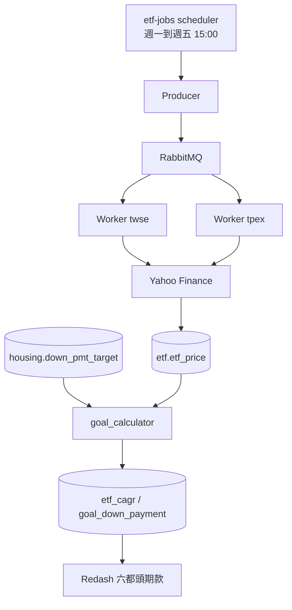

<p align="center"><strong>中文</strong> | <a href="README.en.md">English</a></p>

<h1 align="center">ETF 目標試算</h1>

<p align="center">用被動式 ETF 的歷史報酬，試算六都頭期款每月要存多少。</p>

<p align="center">
  <a href="https://github.com/tibameDataEngineer1150701/etf-goal-calculator/stargazers"></a>
  
  
  
</p>

<p align="center">
  線上儀表板：<a href="http://34.81.69.39:5000">六都頭期款</a>（登入後在 Dashboards 打開）
</p>

GCP 機器 `etf-manager`（`asia-east1-b`，`e2-medium`，`34.81.69.39`）已在跑。股價、房價與試算都在 MySQL。週一到週五 15:00（台北時間）由 Swarm 排程抓價。

Airflow 沒有安裝。這台是 `e2-medium`，記憶體約 4 GB，已經在跑 MySQL、RabbitMQ、兩個 worker、Flower、Portainer 和 Redash。Airflow 自己的網頁、排程和資料庫就要大約 4 GB，再加上去會把機器撐滿。而且 `etf-jobs` 已經在 15:00 抓同一份清單，DAG 再跑一次只會覆寫同一筆股價。

已建立 Docker Hub。Image 是 `mark0403/etf-crawler:0.0.1`，VM 部署時從 Docker Hub 拉下來用。

## 功能

| | | |
| --- | --- | --- |
| 📈 **股價** | Yahoo 還原收盤 `adj_close`，上市 `.TW`、上櫃 `.TWO` | `etf.etf_price` 約 392,253 筆 |
| 📋 **清單** | FinMind 篩掉主動式與槓桿反向 | `stock.etf_list` |
| 🏠 **房價** | 30 坪總價，再依房價指數估 10 年後頭期款 | `housing.down_pmt_target` 36 列 |
| 🧮 **試算** | 成屋買賣、中性。0050 約年化 20.28% | `etf.goal_down_payment` 六都各一列 |
| 📊 **儀表板** | 可改 ETF、年數、每月投入 | Redash「六都頭期款」 |
| ⏱️ **排程** | 兩個 Celery worker 分上市、上櫃 | 週一到週五 15:00 |

`crawlers/finmind` 是另一套日線爬蟲，報酬計算不讀它，讀 `etf.etf_price`。

## Quick Start

VM 已經起來。看資料或圖不用在自己電腦重抓。

| 服務 | 網址 |
| --- | --- |
| Redash | http://34.81.69.39:5000 |
| phpMyAdmin | http://34.81.69.39:8080 |
| RabbitMQ | http://34.81.69.39:15672 |
| Flower | http://34.81.69.39:5555 |
| Portainer | http://34.81.69.39:9000 |

## Installation

本機要自己跑時，先裝 Docker Desktop、Python 3.11 和 [uv](https://docs.astral.sh/uv/)。不要另外啟動 `crawlers/housing` 或 `crawlers/finmind` 裡的 `mysql.yml`，那些檔也佔 3306。

<details>
<summary>Linux / macOS</summary>

```bash
git clone https://github.com/tibameDataEngineer1150701/etf-goal-calculator.git
cd etf-goal-calculator
docker compose -f docker/docker-compose.yml up -d --build mysql phpmyadmin
cd crawlers/stock && uv sync
export MYSQL_HOST=127.0.0.1 MYSQL_PORT=3306 MYSQL_USER=root MYSQL_DATABASE=stock
uv run python -m crawler.save_etf_list
cd ../..
docker compose -f docker/docker-compose.yml run --rm crawler
```

</details>

<details>
<summary>Windows PowerShell</summary>

```powershell
git clone https://github.com/tibameDataEngineer1150701/etf-goal-calculator.git
cd etf-goal-calculator
docker compose -f docker/docker-compose.yml up -d --build mysql phpmyadmin
cd crawlers/stock
uv sync
$env:MYSQL_HOST = "127.0.0.1"
$env:MYSQL_PORT = "3306"
$env:MYSQL_USER = "root"
$env:MYSQL_DATABASE = "stock"
uv run python -m crawler.save_etf_list
cd ../..
docker compose -f docker/docker-compose.yml run --rm crawler
```

</details>

<details>
<summary>VM 上更新抓價程式</summary>

VM 的 MySQL 與 RabbitMQ 已經在網路 `etf_etf`。不要在 VM 再跑本機的 `celery-compose.yml`。

```bash
cd ~/etf-goal-calculator
git pull
sudo docker pull mark0403/etf-crawler:0.0.1
sudo docker stack deploy -c swarm.yml etf-jobs
```

</details>

## Architecture



`dags/etf_etl_dag.py` 會直接跑抓價，不經過 RabbitMQ。Airflow 沒有裝在這台機器上，避免和上面的排程各抓一次。

## 資料與查詢

數字是 2026-11-03 在 VM 上的結果。

| 資料表 | 內容 | 筆數 |
| --- | --- | --- |
| `stock.etf_list` | 被動式 ETF 清單 | 約 279 |
| `etf.etf_price` | `date`、`stock_id`、`adj_close` | 約 392,253 |
| `etf.etf_cagr` | 各檔含息年化報酬 | 有抓到報價的代號 |
| `etf.goal_down_payment` | 六都頭期款與每月需投入 | 6 |
| `housing.down_pmt_target` | 成屋、預售屋與三種情境。試算用成屋買賣、中性 | 36 |
| `housing.housing_txn_qtr` | 六都單價（元／平方公尺）與成交筆數 | 516 |
| `housing.housing_price_index` | 官方房價指數 | 385 |
| `housing.cpi` | 季度 CPI，2016Q1 起 | 43 |
| `housing.hpi` | 實質房價指數。CSV 檔名是 `real_hpi.csv` | 287 |
| `housing.city_house_price` | 2026Q3 總價中位數。有成屋、中性時試算不用這張表 | 6 |

建表在 [`crawlers/etf/schema.sql`](crawlers/etf/schema.sql)。儀表板用的查詢：

```sql
SELECT
  p.city,
  p.house_price_wan,
  p.down_payment,
  c.stock_id,
  ROUND(c.cagr * 100, 2) AS cagr_pct,
  ROUND(
    p.down_payment * (c.cagr / 12)
    / (POW(1 + c.cagr / 12, {{years}} * 12) - 1)
  ) AS monthly_needed,
  ROUND(
    {{monthly_invest}} * (POW(1 + c.cagr / 12, {{years}} * 12) - 1) / (c.cagr / 12)
  ) AS accumulated,
  CASE
    WHEN {{monthly_invest}} * (POW(1 + c.cagr / 12, {{years}} * 12) - 1) / (c.cagr / 12)
         >= p.down_payment
    THEN '可付' ELSE '不足'
  END AS can_pay
FROM (
  SELECT
    CASE region
      WHEN '臺北市' THEN '台北市'
      WHEN '臺中市' THEN '台中市'
      WHEN '臺南市' THEN '台南市'
      ELSE region
    END AS city,
    ROUND(house_price / 10000) AS house_price_wan,
    ROUND(down_payment_target) AS down_payment
  FROM housing.down_pmt_target
  WHERE transaction_type = '成屋買賣'
    AND scenario = '中性'
) p
JOIN etf_cagr c ON c.stock_id = '{{etf}}'
ORDER BY p.house_price_wan DESC
```

ETF 下拉要先存並執行 `SELECT stock_id FROM etf_cagr ORDER BY stock_id`。長條圖 X 軸 `city`、Y 軸 `monthly_needed`。加到儀表板時，參數來源選 Dashboard，再 Publish。

房價管線：

- `WebCrawler_cpi.py`：當月、未來月份，以及緊鄰的前一個月若是非正數，視為尚未發布並排除。2026 年 11 月初排除 `2026-M10` 和 `2026-M11`。
- `Real_HPI.py` 已併入組員 `real-estate-hpi-cpi-pipeline` 的 `c10e92a`。各地區官方 HPI 先換成 2016 年四季平均為 100，再除以同樣基期的 CPI。成屋和預售屋以交易類型分開。Python 3.11 印出 CPI 平均值的那一行已改成先算再印。

本機環境變數見 `crawlers/etf/goal_calculator.py` 開頭。常用的有 `MYSQL_HOST`、`PRIMARY_ETF`（預設 `0050`）、`INVEST_YEARS`（預設 `10`）、`MONTHLY_INVEST`。

## 專案問題

## 常見問題

## Contributors

- [mark900403](https://github.com/mark900403)
- [athlan0726](https://github.com/athlan0726)
- [wayne_hung](https://github.com/wayne_hung)
- [rchingyun](https://github.com/rchingyun)
- [yuyumomo](https://github.com/yuyumomo)

<a href="https://github.com/tibameDataEngineer1150701/etf-goal-calculator/graphs/contributors">
  
</a>

這是課程專案，沒有贊助方案。結果只供資料流程驗證，不構成投資建議。
