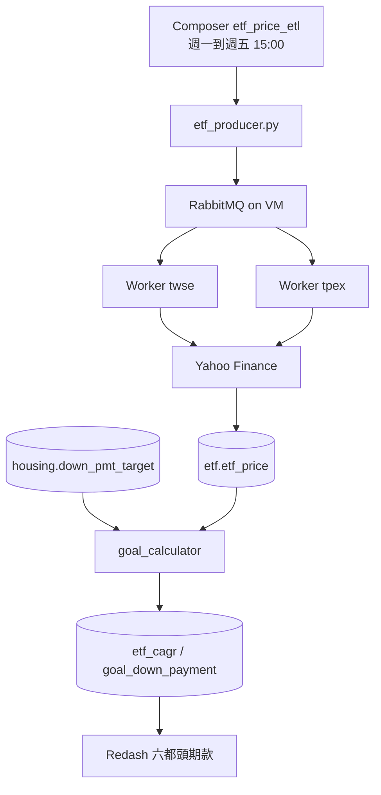

<p align="center"><strong>中文</strong> | <a href="README.en.md">English</a></p>

<h1 align="center">ETF 目標試算</h1>

<p align="center">用被動式 ETF 的歷史報酬，試算六都頭期款每月要存多少。</p>

<p align="center">
  <a href="https://github.com/tibameDataEngineer1150701/etf-goal-calculator/stargazers"></a>
  
  
  
</p>

<p align="center">
  線上儀表板：<a href="http://34.81.69.39:5000">六都頭期款</a>（登入後在 Dashboards 打開）
</p>

GCP 機器 `etf-manager`（`asia-east1-b`，`e2-medium`，外部 IP `34.81.69.39`，內部 IP `10.140.0.2`）已在跑。股價、房價與試算都在 MySQL。

週一到週五 15:00（台北時間）由專案 `etf-goal` 裡共用的 Composer 環境 `composer`（`us-east4`，Airflow 2.11.1）排程。DAG `etf_price_etl` 用 `KubernetesPodOperator` 跑 `etf_producer.py`，把 `stock.etf_list` 送到 VM 上的 RabbitMQ。上市、上櫃兩個 worker 留在 VM 領任務。`etf-jobs` 的 scheduler 已縮成 0，避免同一時間再送一次。2026-11-09 15:00 的排程已成功，worker 收到 `etf.crawl_one` 並寫進 MySQL。`etf.etf_price` 最新日期是 2026-11-09，共 393,883 筆；當天 236 檔有價格，11/6 是 279 檔，部分 Yahoo 請求失敗。MySQL `3306` 與 RabbitMQ `5672` 只對 Composer Pod 網段 `10.28.0.0/17` 開放。

VM 沒有自架 Airflow。這台是 `e2-medium`，記憶體約 4 GB，已經在跑 MySQL、RabbitMQ、兩個 worker、Flower、Portainer 和 Redash。Airflow 自己的網頁、排程和資料庫就要大約 4 GB。Composer 建在同一個 GCP 專案，全組共用這一個環境。

Docker Hub 帳號是 `mark0403`。VM 的 worker 用 `mark0403/etf-crawler:0.0.1`。Composer 的 producer 用 `mark0403/etf-crawler:0.0.2.composer`，由 `docker/prod.with.env.Dockerfile` 建置。連線密碼放在 Composer 的 Airflow Variables `mysql_password`、`rabbitmq_password`，不寫進 Git。

## 功能

| | | |
| --- | --- | --- |
| 📈 **股價** | Yahoo 還原收盤 `adj_close`，上市 `.TW`、上櫃 `.TWO` | `etf.etf_price` 393,883 筆，最新 2026-11-09 |
| 📋 **清單** | FinMind 篩掉主動式與槓桿反向 | `stock.etf_list` 333 檔 |
| 🏠 **房價** | 30 坪總價，再依房價指數估 10 年後頭期款 | `housing.down_pmt_target` 36 列 |
| 🧮 **試算** | 成屋買賣、中性。0050 約年化 20.28% | `etf.goal_down_payment` 六都各一列 |
| 📊 **儀表板** | 可改 ETF、年數、每月投入 | Redash「六都頭期款」 |
| ⏱️ **排程** | Composer 送任務，VM 上兩個 Celery worker 分上市、上櫃 | 週一到週五 15:00 |

`crawlers/finmind` 是另一套日線爬蟲，報酬計算不讀它，讀 `etf.etf_price`。

## Quick Start

VM 已經起來。看資料或圖不用在自己電腦重抓。

| 服務 | 網址 |
| --- | --- |
| Redash | http://34.81.69.39:5000 |
| phpMyAdmin | http://34.81.69.39:8080 |
| RabbitMQ | http://34.81.69.39:15672 |
| Flower | http://34.81.69.39:5555 |
| Portainer | http://34.81.69.39:9000 |
| Airflow | [Composer `composer`](https://9ac02a6cb8fc427eb49d61045f3e7fc2-dot-us-east4.composer.googleusercontent.com) |

## Installation

本機要自己跑時，先裝 Docker Desktop、Python 3.11 和 [uv](https://docs.astral.sh/uv/)。不要另外啟動 `crawlers/housing` 或 `crawlers/finmind` 裡的 `mysql.yml`，那些檔也佔 3306。

<details>
<summary>Linux / macOS</summary>

```bash
git clone https://github.com/tibameDataEngineer1150701/etf-goal-calculator.git
cd etf-goal-calculator
docker compose -f docker/docker-compose.yml up -d --build mysql phpmyadmin
cd crawlers/stock && uv sync
export MYSQL_HOST=127.0.0.1 MYSQL_PORT=3306 MYSQL_USER=root MYSQL_DATABASE=stock
uv run python -m crawler.save_etf_list
cd ../..
docker compose -f docker/docker-compose.yml run --rm crawler
```

</details>

<details>
<summary>Windows PowerShell</summary>

```powershell
git clone https://github.com/tibameDataEngineer1150701/etf-goal-calculator.git
cd etf-goal-calculator
docker compose -f docker/docker-compose.yml up -d --build mysql phpmyadmin
cd crawlers/stock
uv sync
$env:MYSQL_HOST = "127.0.0.1"
$env:MYSQL_PORT = "3306"
$env:MYSQL_USER = "root"
$env:MYSQL_DATABASE = "stock"
uv run python -m crawler.save_etf_list
cd ../..
docker compose -f docker/docker-compose.yml run --rm crawler
```

</details>

<details>
<summary>VM 上更新抓價程式</summary>

VM 的 MySQL 與 RabbitMQ 已經在網路 `etf_etf`。不要在 VM 再跑本機的 `celery-compose.yml`。

```bash
cd ~/etf-goal-calculator
git pull
sudo docker pull mark0403/etf-crawler:0.0.1
sudo docker stack deploy -c swarm.yml etf-jobs
sudo docker service scale etf-jobs_scheduler=0
```

`swarm.yml` 裡的 scheduler 預設是 1 個複本。部署後要縮成 0，15:00 才只由 Composer 送任務。兩個 worker 維持 1。

</details>

## Architecture



`dags/etf_etl_dag.py` 只負責派送。抓價在 VM 的 worker。本機練習仍可用 `docker/celery-compose.yml`：先起 MySQL，再起 compose，用 `--profile dispatch` 派送。

## 資料與查詢

數字是 2026-11-03 在 VM 上的結果。

| 資料表 | 內容 | 筆數 |
| --- | --- | --- |
| `stock.etf_list` | 被動式 ETF 清單 | 約 279 |
| `etf.etf_price` | `date`、`stock_id`、`adj_close` | 約 392,253 |
| `etf.etf_cagr` | 各檔含息年化報酬 | 有抓到報價的代號 |
| `etf.goal_down_payment` | 六都頭期款與每月需投入 | 6 |
| `housing.down_pmt_target` | 成屋、預售屋與三種情境。試算用成屋買賣、中性 | 36 |
| `housing.housing_txn_qtr` | 六都單價（元／平方公尺）與成交筆數 | 516 |
| `housing.housing_price_index` | 官方房價指數 | 385 |
| `housing.cpi` | 季度 CPI，2016Q1 起 | 43 |
| `housing.hpi` | 實質房價指數。CSV 檔名是 `real_hpi.csv` | 287 |
| `housing.city_house_price` | 2026Q3 總價中位數。有成屋、中性時試算不用這張表 | 6 |

建表在 [`crawlers/etf/schema.sql`](crawlers/etf/schema.sql)。儀表板用的查詢：

```sql
SELECT
  p.city,
  p.house_price_wan,
  p.down_payment,
  c.stock_id,
  ROUND(c.cagr * 100, 2) AS cagr_pct,
  ROUND(
    p.down_payment * (c.cagr / 12)
    / (POW(1 + c.cagr / 12, {{years}} * 12) - 1)
  ) AS monthly_needed,
  ROUND(
    {{monthly_invest}} * (POW(1 + c.cagr / 12, {{years}} * 12) - 1) / (c.cagr / 12)
  ) AS accumulated,
  CASE
    WHEN {{monthly_invest}} * (POW(1 + c.cagr / 12, {{years}} * 12) - 1) / (c.cagr / 12)
         >= p.down_payment
    THEN '可付' ELSE '不足'
  END AS can_pay
FROM (
  SELECT
    CASE region
      WHEN '臺北市' THEN '台北市'
      WHEN '臺中市' THEN '台中市'
      WHEN '臺南市' THEN '台南市'
      ELSE region
    END AS city,
    ROUND(house_price / 10000) AS house_price_wan,
    ROUND(down_payment_target) AS down_payment
  FROM housing.down_pmt_target
  WHERE transaction_type = '成屋買賣'
    AND scenario = '中性'
) p
JOIN etf_cagr c ON c.stock_id = '{{etf}}'
ORDER BY p.house_price_wan DESC
```

ETF 下拉要先存並執行 `SELECT stock_id FROM etf_cagr ORDER BY stock_id`。長條圖 X 軸 `city`、Y 軸 `monthly_needed`。加到儀表板時，參數來源選 Dashboard，再 Publish。

房價管線：

- `WebCrawler_cpi.py`：當月、未來月份，以及緊鄰的前一個月若是非正數，視為尚未發布並排除。2026 年 11 月初排除 `2026-M10` 和 `2026-M11`。
- `Real_HPI.py` 已併入組員 `real-estate-hpi-cpi-pipeline` 的 `c10e92a`。各地區官方 HPI 先換成 2016 年四季平均為 100，再除以同樣基期的 CPI。成屋和預售屋以交易類型分開。Python 3.11 印出 CPI 平均值的那一行已改成先算再印。

本機環境變數見 `crawlers/etf/goal_calculator.py` 開頭。常用的有 `MYSQL_HOST`、`PRIMARY_ETF`（預設 `0050`）、`INVEST_YEARS`（預設 `10`）、`MONTHLY_INVEST`。正式環境的主機在 `crawlers/etf/local.ini.example` 的 `PRODUCTION`，範本密碼不要提交。

## 尚未完成

- 架構圖目前只在這份 README 的 Mermaid，還沒有另外上傳圖檔。

## 專案問題

1. Data Ingestion（資料擷取）
Technical Challenge：資料來源存取限制與多來源資料擷取
- 爬蟲存取限制
  - 問題：內政部實價登錄服務網 TLS 憑證驗證或網站存取限制，導致爬蟲無法正常取得資料。
  - 解決方式：針對特定來源測試 verify=False，排除憑證驗證問題；正式環境仍應優先使用有效憑證。
  - 建議：若是正式環境，應優先修正 CA 憑證或使用正確的憑證鏈。
- 實價登錄篩選條件過於複雜
  - 問題：內政部實價登錄服務網首頁需輸入多個篩選條件，增加爬蟲程式複雜度及維護成本。
  - 解決方式：改爬取"登入後頁面"、下載10年內各季度 ZIP 壓縮檔，降低爬取及篩選的複雜度。
- 多個來源資料格式不一致
  - 問題：不同公開資料的欄位及檔案格式不同，無法直接整合。
  - 解決方式：依資料來源設計不同爬蟲模組，完成初步資料清洗及欄位標準化，最後彙整為 Parquet 格式供後續分析。
- 不同資料來源需要不同擷取方式
  - 問題：ETF 基本清單及 ETF 歷史價格來自不同資料來源，資料格式及 API 存取方式不同。
  - 解決方式：
    - 使用 FinMind 擷取被動式 ETF 清單。
    - 使用 Yahoo Finance 擷取上市（.TW）及上櫃（.TWO）ETF 價格。
    - 分別建立資料擷取模組，降低不同來源耦合。
- 外部 API 請求失敗
  - 問題：Yahoo Finance 部分請求失敗，造成特定 ETF 在部分交易日缺少價格資料。
  - 解決方式：
    - 將上市與上櫃 ETF 分開處理。
    - 透過 Worker 分別執行資料擷取。
    - 記錄失敗任務，方便後續追蹤及補抓。

2. Data Quality（資料品質控管）
Technical Challenge：資料缺漏、格式異常及資料完整性驗證
- HPI、CPI 資料存有空值或異常值
  - 問題：資料存在欄位缺漏、資料型態不同、數值異常或重複紀錄，影響 CAGR 計算結果。
  - 解決方式：建立`validate_source_data()`，計算 CAGR 前先驗證資料欄位、資料型態、數值範圍及資料唯一性。
- CSV Schema 不一致
  - 問題：部分 CSV raw data 欄位數量與 Header 不一致，致使讀取錯誤或資料遺失。
  - 解決方式：檢查 Header 與異常資料列，針對異常紀錄進行調查及正規化處理，避免直接跳過有效資料。
- 重複資料及不合理交易紀錄
  - 問題：重複交易、無效日期、缺漏值或非正數交易價格可能影響統計結果。
  - 解決方式：執行重複紀錄、交易日期驗證及價格合理性檢查，如有異常則報錯，程式繼續執行。
- 部分 ETF 價格資料缺漏
  - 問題：外部 API 請求可能失敗，導致不同 ETF 的最新資料日期及筆數不一致。
  - 實際情況：README 記錄 2026/11/09 有 236 檔 ETF 取得價格，前一交易資料日 2026/11/06 有 279 檔。
  - 解決方式及改善方向：
    - 檢查 ETF 清單與價格資料的覆蓋率。
    - 檢查每檔 ETF 最新價格日期。
    - 識別缺少價格的 ETF。
    - 對失敗任務進行重試及補抓。
- ETF 價格資料的有效性
  - 問題：價格資料可能存在空值、非正數或重複紀錄，影響 CAGR 計算。
  - 資料驗證機制：
    - stock_id 不可為空。
    - date 格式正確。
    - adj_close 必須為正數。
    - 檢查 (stock_id, date) 唯一性。

3. Data Transformation（資料轉換）
Technical Challenge：資料格式標準化與時間序列轉換
- 不同資料來源格式及欄位定義不一致
  - 問題：實價登錄、HPI、CPI 使用不同的欄位名稱、日期格式及資料結構，無法直接進行運算。
  - 解決方式：透過 Pandas 進行欄位轉換、資料型態標準化及資料清洗。
- 不同資料來源時間顆粒度不同
  - 問題：CPI 為月資料，HPI 及實價登錄為季度資料，無法直接整合與比較。
  - 解決方式：將 CPI 月資料轉換為季度平均值，讓三份資料時間維度一致。
- HPI(名目房價指數)與Real HPI(實質房價指數)比較
  - 問題：名目房價指數未考量物價變動，無法直接反映排除通膨後的房價變化。
  - 解決方式：將 CPI 正規化至 2016 年基期 100，再結合 CPI 計算 Real HPI。

4. Data Selection & Filtering（資料篩選）
Technical Challenge：大量原始資料選擇性擷取
- 非必要資料增加處理負擔
  - 問題：實價登錄 ZIP 壓縮檔包含多種類型 CSV，若完整解壓縮及清洗，將增加磁碟 I/O、儲存空間及處理時間。
  - 解決方式：
    - 透過`zip_ref.namelist()`篩選 A(成屋買賣), B CSV(預售屋買賣)、排除不需要的 C CSV (租賃)。
    - 僅擷取必要交易資料及相關 schema、manifest 檔案，以利後續資料清洗順利執行。
- 無效資料影響分析結果
  - 問題：部分資料不符合專案預設範圍或分析條件，例如特殊豪宅建案。
  - 解決方式：依照交易類型、日期、價格及地區等條件進一步篩選。

5. Data Integration（資料整合）
Technical Challenge：跨縣市及多來源資料期間對齊
- 不同縣市最新資料季度不一致
  - 問題：各縣市實價登錄資料更新時間不同，最新可用季度不一定一致，若直接比較可能產生時間偏差。
  - 解決方式：
    - 定義統一資料期間對齊規則。
    - 依照研究需求設定共同分析期間。
    - 檢查各縣市資料覆蓋範圍。
- 不同來源的季度資料整合
  - 問題：實價登錄、HPI、CPI 資料期間及時間欄位定義不同。
  - 解決方式：建立標準化季度欄位並作為主鍵，用以合併資料，確保資料期間一致。

6. Data Pipeline Reliability（資料管線可靠性）
Technical Challenge：長時間資料下載、中斷恢復及任務監控
- 大量歷史資料下載耗時且可能意外中斷
  - 問題：下載 10 年實價登錄歷史 ZIP 檔案需較長時間，若程式中斷，可能造成下載不完整或重複。
  - 解決方式：
    - `zip_path.exists()`檢查檔案是否存在。
    - `zipfile.is_zipfile()`驗證檔案是否為有效 ZIP，避免僅依檔案存在與否判斷下載成功。
    - 設定季度下載間隔，降低連續請求頻率。
    - 保留 Error Log，方便定位失敗季度及後續重試。
- 多項 ETL 任務需要獨立執行與管理
  - 問題：實價登錄、HPI、CPI 資料擷取及處理流程不同，若集中執行，不利於任務管理及擴展。
  - 解決方式：
    - 使用 Celery 執行非同步任務。
    - 使用 RabbitMQ 作為 Message Broker。
    - 依資料來源建立獨立 Queue 及 Worker。
    - 使用 Flower 監控任務執行狀態。
- 執行環境及服務管理
  - 問題：多個服務需要一致的執行環境及穩定的 Container 間通訊。
  - 解決方式：使用 Docker、Docker Compose 建立容器化環境，並透過 Docker Network 管理服務間連線。

7.Distributed Task Processing（分散式任務處理）
Technical Challenge：大量 ETF 個別抓價任務的分流與平行處理
- 單一 Worker 處理大量 ETF 任務的效率問題
  - 問題：ETF 商品數量多，每檔 ETF 都需要獨立取得歷史價格，若集中由單一 Worker 執行，容易增加處理時間。
  - 解決方式：
    - 使用 Celery 建立非同步任務。
    - 使用 RabbitMQ 作為 Message Broker。
    - 將上市及上櫃 ETF 分別派送給不同 Worker。
    - 使用 Flower 監控任務執行狀態。
    
## 常見問題

- HPI 基期不同於國家政策研究基金會《臺灣房價指數的比較與應用》基期(⺠國102年全年=100)
  - 資料期間設定為2016~2026(10年)
  - 程式假設HPI 基期 = 2016 = 100
  - 注重趨勢(相對)、不解讀比基期高多少%(絕對)
- 坪數⼝徑
  - 實價登錄單價以含公設的移轉⾯積計算
  - 假設坪數為權狀坪數，以免坪數口徑不一致而⾼估或低估總價
- HPI 只計算至縣市，若使⽤者選⾏政區，會套用全市成⻑率。
  - 預設為10年內(2036年)購買六都不動產，故注重於縣市資料。
- 2016~2026是多頭⼗年，用以推測下⼀個⼗年恐失真。
  - 不構成投資建議，僅專注於程式邏輯、資料流、資料工程與技術。

## Contributors

- [mark900403](https://github.com/mark900403)
- [athlan0726](https://github.com/athlan0726)
- [wayne_hung](https://github.com/wayne_hung)
- [rchingyun](https://github.com/rchingyun)
- [yuyumomo](https://github.com/yuyumomo)

<a href="https://github.com/tibameDataEngineer1150701/etf-goal-calculator/graphs/contributors">
  
</a>

這是課程專案，沒有贊助方案。結果只供資料流程驗證，不構成投資建議。
